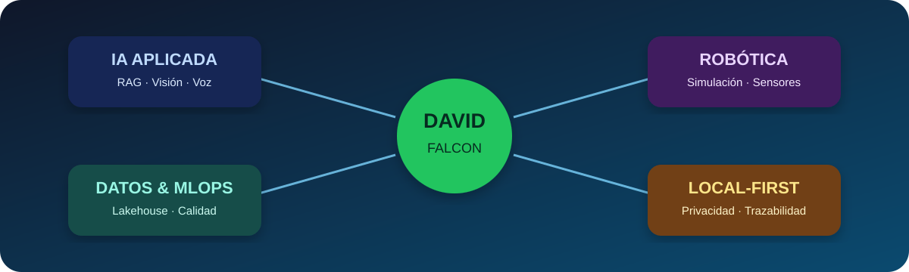

  

<h1 align="center">David Falcon · IA aplicada, datos y robótica</h1>

  Desarrollo sistemas prácticos y explicables: desde telemetría industrial y visión artificial hasta herramientas locales de IA, datos y privacidad.

  
  
  

## En qué trabajo

| Área | Enfoque |
| --- | --- |
| 🤖 Robótica y automatización | Prototipos verificables, simulación, telemetría, sensores y herramientas de apoyo al diseño. |
| 📊 Datos y MLOps | Pipelines reproducibles, calidad de datos, lakehouse, evaluación RAG y monitorización de drift. |
| 🧠 IA aplicada | RAG local, visión artificial explicable, asistentes de voz y evaluación responsable. |
| 🔒 Sistemas locales | Privacidad, trazabilidad y herramientas que funcionan sin depender de una API en la nube. |

## Proyectos destacados

| Proyecto | Qué demuestra |
| --- | --- |
| 🏭 [FactoryPulse](https://github.com/david2526IA/factorypulse-orchestrator) | Plataforma de referencia completa: telemetría → lakehouse → anomalías → API → dashboard → recomendaciones. |
| 👁️ [VisionInspect](https://github.com/david2526IA/visioninspect) | Inspección visual explicable para superficies industriales. |
| 🦾 [Robot Trajectory Guard](https://github.com/david2526IA/robot-trajectory-guard) | Validación offline de límites articulares antes de simulación o integración robótica. |
| 📚 [LocalDocs](https://github.com/david2526IA/localdocs) | Búsqueda documental local y trazable, con fuentes visibles. |
| 📈 [RAG Eval Lite](https://github.com/david2526IA/rag-eval-lite) | Métricas reproducibles para evaluar recuperación en sistemas RAG. |
| 🌡️ [Sensor Calibration Kit](https://github.com/david2526IA/sensor-calibration-kit) | Análisis de calibración lineal y residuos para sensores. |

Consulta el [catálogo de proyectos en español](PROYECTOS.md) para ver todas las piezas, su propósito y cómo se conectan.

## Criterio de ingeniería

- Cada proyecto incluye documentación, pruebas automatizadas y CI.
- Distingo claramente prototipos, herramientas de análisis y sistemas de producción.
- No presento como control industrial ni como seguridad funcional aquello que solo es una ayuda de software.
- Priorizo resultados reproducibles, límites explícitos y datos que se puedan auditar.

## Tecnologías

`Python` · `FastAPI` · `DuckDB` · `SQLite` · `Docker` · `Linux` · `GitHub Actions` · `RAG` · `Computer Vision` · `Robótica` · `TIA Portal` · `HMI/SCADA`

## English summary

I build practical, explainable systems across applied AI, robotics, industrial telemetry and data engineering. The highlighted repositories include reproducible documentation, automated tests and clear operational limits. I favour local-first designs, traceable outputs and safe integration boundaries.

<i>Construyendo IA que sale de la pantalla y funciona en el mundo real.</i>

