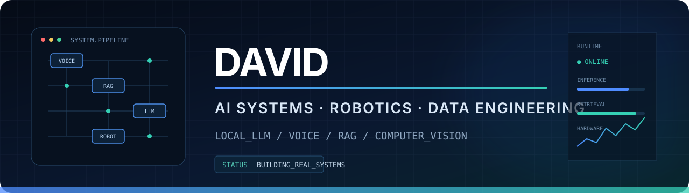

<p align="center">
  
</p>

<p align="center">
  <a href="https://github.com/Bravo-Robots"></a>
  <a href="https://huggingface.co/BravoRobots"></a>
  
</p>

## Sobre mí

Construyo sistemas de **inteligencia artificial aplicada y robótica social** que
conectan modelos locales, voz, recuperación de conocimiento y hardware real.

Mi trabajo se centra en convertir prototipos en productos utilizables:
instalación automática, procesamiento privado, trazabilidad de datos,
diagnóstico y una experiencia sencilla para quien utiliza el sistema.

```text
IA local  ·  Reachy Mini  ·  RAG  ·  Voz  ·  Computer Vision  ·  Data Engineering
```

## Proyectos destacados

### ⚖️ [LexIA](https://huggingface.co/spaces/BravoRobots/lexia)

Asistente jurídico por voz para Reachy Mini. Combina documentación oficial,
recuperación trazable, Qwen local, Faster-Whisper, Piper y expresión robótica.
Se instala desde el catálogo de aplicaciones y prepara automáticamente modelos,
base de conocimiento e índices.

### 🍽️ [School Menu Assistant](https://github.com/david2526IA/school-menu-assistant)

Asistente de comedor escolar para Reachy Mini. Permite consultar, corregir y
aprobar menús hablando, con reglas deterministas para precios, alérgenos y
cumplimiento del pliego.

### 🏺 [ArchaeoSort Dataset Builder](https://github.com/david2526IA/archaeosort-dataset-builder)

Pipeline reproducible para construir y auditar datasets arqueológicos de visión
artificial: calidad de imagen, duplicados, embeddings DINOv2, FAISS, outliers y
revisión humana.

## Laboratorios y ecosistema

Repositorios de estudio y adaptación técnica que complementan los proyectos
propios. Se identifican por separado porque parten de trabajos existentes.

| Repositorio | Enfoque |
|---|---|
| [RAG + llama.cpp Starter](https://github.com/david2526IA/rag-llama-cpp-starter) | Arquitectura RAG local y despliegue dockerizado |
| [Dask 500 GB](https://github.com/david2526IA/demo_dask_500gb-) | Procesamiento distribuido desde un portátil y salida a S3 |
| [OpenArm](https://github.com/david2526IA/openarm) | Hardware abierto y physical AI para manipulación robótica |

## Áreas de trabajo

| Área | Qué construyo |
|---|---|
| Robótica social | Experiencias de voz, gestos y estados para Reachy Mini |
| Modelos locales | Qwen, llama.cpp, cuantización y ejecución sin APIs externas |
| Sistemas RAG | Recuperación híbrida, SQL, evidencia y trazabilidad de fuentes |
| Voz | VAD, Faster-Whisper, Piper, streaming e interrupciones naturales |
| Visión artificial | DINOv2, FAISS, validación y auditoría de datasets |
| Data engineering | Procesamiento distribuido, Spark, Dask, Kafka y almacenamiento S3 |
| Producto | Bootstrap automático, caché, diagnósticos, dashboards y despliegue |

## Tecnologías

<p>
  
  
  
  
  
  
  
  
  
</p>

## Principios

- **Privacidad por diseño:** procesar localmente siempre que el caso lo permita.
- **Evidencia antes que elocuencia:** una respuesta debe poder justificar su origen.
- **Automatización real:** instalar y arrancar sin pedir al usuario que configure Python.
- **Hardware con propósito:** los movimientos y la voz forman parte de la interfaz.
- **Medir antes de optimizar:** precisión, latencia y errores por etapa.

---

<p align="center">
  <strong>Construyendo IA que sale de la pantalla y funciona en el mundo real.</strong>
</p>
